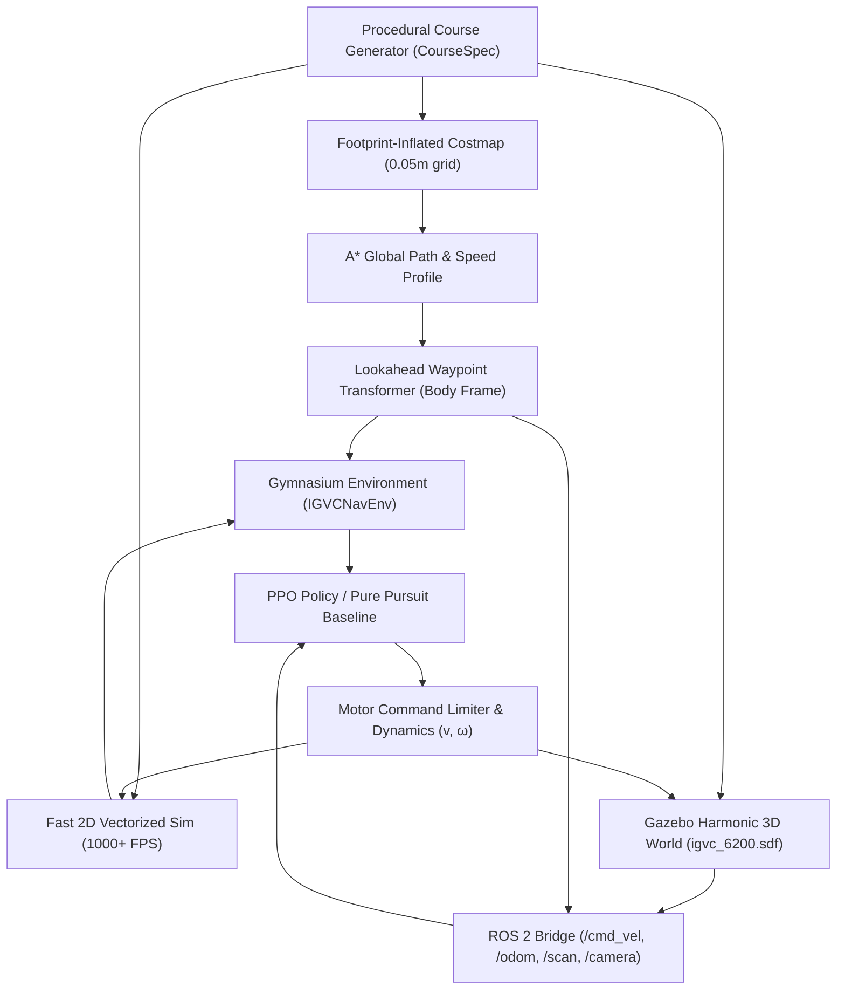

# IGVC-RL Autonomous Navigation Plan & Architecture Roadmap

**Repository:** `https://github.com/ChineseChen123/igvc-rl`  
**Target Compute:** Intel NUC 12 Extreme (`igvc-NUC12DCMi9`, Ubuntu 24.04 LTS, ROS 2 Jazzy, Gazebo Harmonic 8.15.0, RTX 3060 12GB) and macOS Apple Silicon (local development & vectorized training).  
**Status:** Completed Foundations (Phase 0–6); Ready for Production Training Campaigns & On-Robot ROS 2 Integration.

---

## 1. System Architecture Overview

The `igvc-rl` repository is purely dedicated to **Reinforcement Learning and Classical Guidance Navigation**. All course boundaries and obstacles are preprogrammed (known ground truth in simulation), eliminating noisy perception loops from the initial navigation policy learning.

---

## 2. Completed Milestones

### Phase 0: Architecture & Package Skeleton
- [x] Modern Python package configuration with `pyproject.toml` (Hatchling build-backend, PyTorch 2.3+, Gymnasium 1.0+, SB3 2.4+, Shapely 2.0+).
- [x] Comprehensive `.gitignore` excluding build artifacts, local virtual environments, checkpoints, and system caches.
- [x] Full documentation: `ARCHITECTURE.md`, `MIGRATION.md`, `ASSUMPTIONS.md`, `GAZEBO_ROBOT.md`, `VERIFICATION.md`.

### Phase 1: Gazebo Simulation Asset Migration
- [x] Migrated all 73 mesh OBJ files, textures, and models from `igvc-procedural` into `sim/gazebo/igvc_blender_course/`.
- [x] Migrated SDF worlds (`igvc_6200.sdf`, `igvc_6200_pov.sdf`) and launch files (`course.launch.py`, `vehicle_pov.launch.py`).
- [x] Preserved vertex normals repair tool (`sim/blender/fix_gazebo_obj_normals.py`) and Blender exporter (`sim/blender/export_gazebo.py`).
- [x] Verified course 6200 fixtures (`metadata.json`, `geometry.json`, `render-config.json`) with zero dependency on the legacy repository.

### Phase 2: Standalone Procedural Course Geometry
- [x] Implemented pure Python `src/igvc_rl/course/` without external dependencies on ROS, Gazebo, or Blender.
- [x] Exact analytical sinusoidal centerline ($x(y) = A \sin(ky + \phi)$), variable lane width constriction ($3.6\text{m} \to 3.048\text{m}$), and boundary offsets.
- [x] Analytical obstacle placement (staggered barrels $r=0.29\text{m}$ and painted pothole discs $r=0.3048\text{m}$).
- [x] `CourseSpec.load_course_6200()` fixture loader matching the physical Gazebo world.

### Phase 3: Costmap & Global A* Guidance Planner
- [x] 2D grid costmap ($0.05\text{m}$ resolution) with conservative footprint inflation ($r_{\text{circ}} \approx 0.58\text{m} + 0.10\text{m}$ margin).
- [x] 8-connected A* search with octile heuristic and strict corner-cutting prevention.
- [x] Path smoothing (supercover edge collision validation) and multi-scale Gaussian smoothing with pinned endpoints.
- [x] Dynamic programming forward-backward speed profile enforcing lateral centripetal limits ($v \le \sqrt{a_{\text{lat}}/\kappa}$), forward acceleration ($0.8\text{m/s}^2$), and terminal braking ($1.2\text{m/s}^2$).
- [x] Lookahead waypoint extractor sampling 8 points in body coordinates: $[0.25, 0.5, 1.0, 1.5, 2.0, 3.0, 4.5, 6.0]\text{m}$.

### Phase 4: Robot Modeling & Dynamics
- [x] Differential drive / skid-steer vehicle model (`provisional_skid_steer.yaml`): mass $50\text{kg}$, footprint $0.90\text{m} \times 0.74\text{m}$, wheel radius $0.14\text{m}$, track width $0.66\text{m}$.
- [x] First-order motor exponential lag ($\tau = 0.15\text{s}$) and exact sub-step actuator delay splitting ($\Delta = 0.05\text{s}$).
- [x] Curvature-preserving wheel velocity scaling under actuator saturation.
- [x] Wheel odometry integrator with configurable slip and Gaussian noise.

### Phase 5: Fast Vectorized Gymnasium Environment
- [x] Vectorized 2D planar raycaster (`sim/raycast.py`) with precomputed geometry and proximity bounding-box culling (~1,000 steps/sec).
- [x] `IGVCNavEnv` supporting standard Gymnasium API (`reset`, `step`, `render`).
- [x] 109-element observation vector (local waypoints, errors, velocities, 64-sector normalized LiDAR returns, boundary distances).
- [x] Continuous normalized action space $[-1, 1]^2$ mapped to velocity limits $[-0.3, 1.5]\text{m/s}$ and $[-1.5, 1.5]\text{rad/s}$.
- [x] Well-behaved reward function with progress incentives, tracking penalties, stagnation termination, and soft goal velocity bonus.

### Phase 6: Gazebo Dynamic Robot & ROS 2 Launch
- [x] Complete dynamic SDF (`robot/description/igvc_robot.sdf`) and URDF (`robot/description/igvc_robot.urdf.xacro`) with physical mass/inertia and 4 revolute wheels.
- [x] Gazebo Harmonic `DiffDrive` system plugin and GPU LiDAR/RGB camera sensor plugins.
- [x] ROS 2 Jazzy launch file (`sim/gazebo/igvc_blender_course/launch/robot_sim.launch.py`) and parameter bridge (`robot_bridge.yaml`).

### Phase 7: Verification & Baselines
- [x] **30/30 unit tests pass** across geometry, dynamics, planning, environments, and simulation assets.
- [x] Pure-pursuit baseline controller achieves **100% success rate (5/5 courses)** with 0 collisions and cross-track RMSE $\approx 2.4\text{cm}$.
- [x] PPO training smoke test verified (500 steps save, reload, and deterministic rollout).
- [x] Zero ruff lint errors across the repository.

---

## 3. Next Actionable Phases (Roadmap)

### Phase 8: Scaled RL Training Campaign
- [ ] Run multi-seed PPO training campaign (1,000,000 transitions across 4 seeds) using `igvc-train --config configs/training/ppo.yaml`.
- [ ] Implement residual RL policy architecture (adding learned continuous $(\Delta v, \Delta \omega)$ corrections on top of pure pursuit guidance).
- [ ] Benchmark policy robustness against severe friction variations ($\mu \in [0.2, 0.9]$), sensor latency ($\Delta \in [50, 150]\text{ms}$), and encoder noise.

### Phase 9: Sim-to-Sim Verification on Target NUC
- [ ] Transfer package to NUC (`/home/igvc/igvc-rl/`).
- [ ] Build workspace with `colcon build --packages-select igvc_blender_course`.
- [ ] Launch full dynamic robot simulation: `ros2 launch igvc_blender_course robot_sim.launch.py`.
- [ ] Validate `/cmd_vel` wheel control, `/odom` wheel odometry publisher, `/scan` GPU LiDAR returns, and `/camera/image`.

### Phase 10: Real-Robot Deployment Integration
- [ ] Connect policy output to Nanotec NanoLib differential motor driver nodes on the physical robot.
- [ ] Integrate with Rutgers ROS 2 Jazzy hardware state publisher.
- [ ] Run live track trials with preprogrammed RTK-GPS waypoint boundaries.
